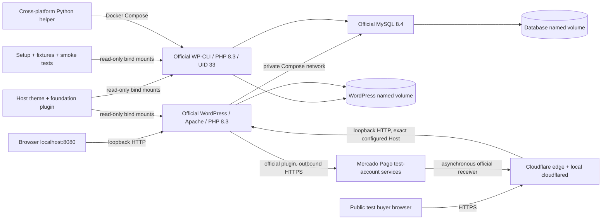

# M01–M06 architecture

## Public source boundary

The project root is the public repository. `.gitignore` excludes private environments, keys, archives, runtime data, dependencies and browser evidence; forced additions of those paths are also rejected by `scripts/check-secrets.py`. This host-only standard-library tool checks current files, staged bytes and reachable history/identities without echoing values. Local pre-commit and pre-push guards are enabled for the root checkout. The prior Git metadata is backed up privately outside the project and OneDrive before native Git operations give `main` a new anonymous root commit. The `.git` directory stays in place; private recovery refs/reflogs/objects are not published by a normal `main` push. Publication checks cover all local branches, tags and HEAD; `--all-refs` is a separate audit of local recovery/editor refs. Working files, services, volumes and credentials remain in place. `scripts/prepare-public.py` remains an optional checked export helper. See [publishing.md](publishing.md).

## M06 verification boundary

The official plugin starts WooCommerce seller onboarding and receives the provider's credential response. The demo's CLI reports only credential and linkage presence. Activation can verify the exact expected Uruguay test seller ID via the existing provider identity check. The backup helper streams the WordPress volume through Docker to private host storage. See [M06 execution evidence](testing-m06.md).

## Current M05 additions

The historical M01 version table below is superseded by the reviewed WordPress **7.1.4** core/image security patch. WC 11.2.1/MP 8.9.7 remain pinned; M04 genuine payment acceptance stays incomplete. M05 status/evidence is in [testing-m05.md](testing-m05.md).

`ANOTTER_ENV_FILE` selects a private absolute environment. `init-qa.py` creates separate credentials, Compose network and DB/core volumes at loopback 8095. Node/axe/Lighthouse/Puppeteer remain test-only. Real WP/WC services and native cookie sessions supply the tests; no mocked successful payments or stock/order integrations are added.

CLI-only `demo-library.php`/`demo.php` preflight a selective rehearsal plan: exact session, reserved synthetic email, exclusively owned products and unpaid BACS without paid date/transaction/refunds. Unknown active inventory orders block reset. Both host and PHP refuse production/staging/nonloopback/public origin; writes need exact-project confirmation. Native cancellation/CRUD precedes deterministic price/stock/sample-rate restoration. No new web endpoint or payment/stock state handler exists. Shared fixture guards and cleanup identity/preflight protect unknown data. Separate projects isolate parallel test inventory; suites remain sequential per DB.

Doctor reads runtime/HTTP readiness as PASS/FAIL/BLOCKED/NOT RUN. Backups use the matching MySQL client (the Alpine MariaDB client cannot authenticate this DB) and exclude host-mounted source/config, which must be preserved separately. Setup never silently replaces persistent core. See the runbook for explicit patch/recovery boundaries.

Presentation fixes preserve tokens/native blocks: Spanish 404, brand names from visible text, native closed mini-cart visibility and checkout-only error/live/skeleton semantics. Native focus/validation/totals/order state stay in charge. Contact reflection is bounded before sanitization while raw input is validated. Apache access logs omit query/Referer; callbacks/Store API remain available. Generated artifacts stay ignored. M05 prepares the demo/storyboard/M06 plan without executing external acceptance or recording a final video.

## Services and storage

`db` has an authenticated `SELECT 1` health check and no published ports. `wordpress` waits for database health; its own health check verifies Apache/core HTTP readiness before installation. The profiled `wpcli` service shares the persistent files/database and runs on demand. The host waits for both health states before setup. Credentials enter via environment variables; a CLI-only PHP script calls native `wp_install()` without printing its return value or passing passwords as arguments. WP-CLI's non-TTY password prompt was found to echo secrets during live M01 validation and was replaced; the exposed local password was rotated. Docker administrators can inspect container environments; these are local demo credentials.

Named `database` and `wordpress` volumes are namespaced by `COMPOSE_PROJECT_NAME`. The WordPress volume contains core, downloaded WooCommerce/translations, uploads and `.htaccess`. Theme and application plugin source overlay only their individual paths read-only. Project-owned `docker/wp-config.php` is mounted read-only at the standard configuration location; it uses environment-based database settings and eight independently generated authentication keys/salts. Unlike the default Docker config template, it controls `WP_DEBUG` directly from the environment type and does not trust arbitrary forwarded HTTPS headers. This is application configuration, not a core patch. This layout avoids relying on Linux ownership changes on Windows bind mounts. Apache uses Debian UID/GID 33; the Alpine CLI image is explicitly run as `33:33` instead of its native UID 82, matching shared-volume ownership. Images come from official repositories. No custom images or build toolchain is needed.

Apache/PHP and WordPress errors go to stderr outside the document root. `WP_DEBUG` and `WP_DEBUG_LOG` are enabled only for `APP_ENV=local`; error display is always disabled. PHP has 512 MB, frontend WordPress 256 MB, administration 512 MB. Core/plugin automatic updates are disabled for reproducibility; manual patch review is required. PHP's image tag pins the 8.3 series, not an exact patch or image digest.

## Version baseline

Verified against upstream official registries on **2026-10-27**:

| Component | Default pin | Rationale/source |
| --- | --- | --- |
| WordPress | `wordpress:7.1.3-php8.3-apache` | Stable core with Apache, supported PHP baseline; [official image manifest](https://github.com/docker-library/official-images/blob/master/library/wordpress) and [release archive](https://wordpress.org/download/releases/) |
| WP-CLI | `wordpress:cli-2.12.0-php8.3` | Official CLI image, same PHP minor; [image manifest](https://github.com/docker-library/official-images/blob/master/library/wordpress) |
| WooCommerce | `11.2.1` | Stable plugin listed as tested through WP 7.1.3; [official plugin directory](https://wordpress.org/plugins/woocommerce/) |
| MySQL | `mysql:8.4.13` | Maintained 8.4 branch instead of an innovation tag; [official image manifest](https://github.com/docker-library/official-images/blob/master/library/mysql) |

These pins make upgrades deliberate and repeatable, while tag rebuilds can still change image bytes. For a delivery requiring byte-for-byte image reproducibility, resolve and record platform-appropriate digests after a successful pull. Do not invent digests or imply images were pulled when the engine is unavailable. Existing persistent core/plugin files are not overwritten just by changing an image tag.

## Application boundaries

- `theme/anotter-demo` is a native block theme (`theme.json` v3), with original provisional artwork, self-hosted Manrope, semantic landmarks, native navigation and reusable patterns. Custom HTML block templates compose WooCommerce 11.2.1's Product Collection, sorting, categories, gallery, add-to-cart, details and related-product APIs. No vendor PHP template is overridden, and no cart/inventory logic is reimplemented. Price, availability, attributes and related items come from WooCommerce. Theme JS only focuses form feedback and reflects native menu state for ARIA; native WordPress retains menu focus management.
- `plugins/anotter-demo-foundation` labels orders, declares HPOS/cart-block compatibility, suppresses mail, supplies the WooCommerce Spanish-language fallback and renders the minimal public contact shortcode. Its form checks a nonce, bounded fields/email, a honeypot and a salted-IP rate counter; it sends/stores no messages. No privileged public action, custom table or outbound HTTP filter is added. Review unconditional mail suppression before any non-demo use.
- `scripts/php` contains CLI-only initialization, separate from normal web requests. WooCommerce owns tables, products, stock, pages, shipping zones and methods. Products use public CRUD APIs; no custom table or core modifications.
- `tests` checks real application state and HTTP endpoints. Snapshot tests use read-only queries of core tables for complete user/page/media comparison; commerce writes always use WooCommerce CRUD. Host tests verify safe credential generation and config validation without mocking WordPress.

## Initialization and extension strategy

An empty database gets native `wp_install()` through the silent CLI-only installer and a managed-demo marker. Existing installations without the marker are refused. First-run options, home page and shipping each have persistent markers; normal reruns preserve them. Official `WC_Install::create_pages()` creates missing native pages without replacing existing page content. Products are keyed by unique SKUs and only missing products are seeded. Never concurrently run initialization. If a process is interrupted in the tiny interval after core installation and before its ownership marker, manual inspection or an explicit disposable-demo reset is required.

M02's `storefront.php` migration creates missing informational/legal demo pages, imports artwork only over recognized M01 placeholders, adds fictional attributes only where none exist, and appends a shared native demo product tag for related-product discovery. It preserves merchant edits and uses separate metadata markers so subsequent setup does not reseed them. Untouched default English WooCommerce page titles are translated while IDs/slugs remain stable. All commerce writes use native APIs.

The existing core es_UY translation is incomplete, and WooCommerce has no es_UY pack. Setup installs the Spanish fallback, loaded for PHP and matching script translation files under the site locale. The theme supplies only three missing native navigation/skip-link strings. Store locale, country, UYU, stock, shipping and noindex settings remain unchanged.

Playwright is a locked development-only dependency. It tests the real server at five widths, keyboard navigation/FAQ, current product data, cart quantities/subtotals, native out-of-stock rejection, form validation and frontend errors, and exports screenshots. A marked temporary product is created/cleaned with WooCommerce CRUD; existing inventory is preserved. Browser output and Node modules are ignored. No frontend build/runtime service is added.

M03 adds native cart/checkout/confirmation styling and two managed Uruguay shipping zones. `commerce.php` initializes native DAC/UES flat-rate instances, offline BACS, required phone, stock thresholds/hold, provisional terms/privacy links and email colors. It preserves existing prices/quantities and later admin edits. The old M01 zone remains behind the new zones for audit. `checkout-pages.php` enhances only exact hashes of the untouched pinned native cart/checkout defaults, backing up their original content; customized pages are skipped. The theme retains native commerce blocks, summaries, validation and submission. No vendor PHP template or order persistence is replaced.

All totals, coupons, shipping, stock locks/reduction/restoration and order states remain WooCommerce-owned. The demo plugin localizes Uruguay address labels and adds an unpaid/status explanation through the supported confirmation text filter, after native order access checks. A narrow `woocommerce_query_for_reserved_stock` filter keeps existing reservations visible through reducing statuses until native callbacks release them, addressing the observed status-save/reduction race without writing order/stock internals. HPOS is active. The existing demo marker applies to block, REST and admin orders. No custom inventory mutation or status handler exists.

The foundation plugin suppresses all `wp_mail` output. In local/development environments it captures up to ten bounded previews addressed only to reserved `.invalid` recipients, in a non-autoloaded core option. An admin submenu protected by both `manage_woocommerce` and `manage_options` displays sandboxed previews; deletion requires a nonce. Other addresses are suppressed without capture. This adds no service, transport or public endpoint, and does not change the contact form's validation-only behavior.

The M03 browser suite tests real Store API cart/coupon/checkout behavior, five-width layouts, guest order creation, native administration, access controls and a simultaneous last-unit race. Isolated marked products, coupons and orders are removed via native CRUD; cancellation/refund/expiration tests exercise the installed WooCommerce callbacks, not custom stock writes. Fixture cleanup explicitly distinguishes orders from refunds. Expanded persistence snapshots include M03 gateway, shipping, inventory and page configuration. See [checkout-flow.md](checkout-flow.md), [shipping.md](shipping.md) and [testing-m03.md](testing-m03.md).

M04 installs checksum-verified official Mercado Pago 8.9.7 into the existing WordPress volume. It declares HPOS/Blocks compatibility; its WooCommerce tested-up-to header is 11.0.1, below our 11.2.1. Native checkout is retained; live uncredentialed checks are distinct from pending provider acceptance. No payment code is forked or vendored.

Cloudflared connects only to loopback Apache. `docker/public-origin.php` recognizes the exact configured Quick Tunnel Host, sets WordPress HTTPS and per-request `WP_HOME`/`WP_SITEURL`, and rejects unknown web hosts. It ignores forwarded headers. Local requests retain canonical database URLs. CLI public diagnostics explicitly use `--url`. A render-only filter adapts saved editorial local-origin links; database content is not replaced. Apache denies diagnostic artifacts and WooCommerce logs. No database/tool port is tunneled.

`includes/payments.php` limits official gateway eligibility to Checkout Pro, the official MLU test-seller identity, sales mode and the configured public origin. CLI activation additionally confirms test identity with the provider before changing native settings; no custom payment activation bypass exists. Credentials use official plugin storage; no token environment mapping or custom secret store is added. The official plugin owns preference amounts, redirects, notification handlers, API reads and native order completion. Its receiver is not replaced. See [payment-flow.md](payment-flow.md) for the actual IPN/Core paths and verification limitations. M05 preparation is tracked separately in testing-m05.md.
