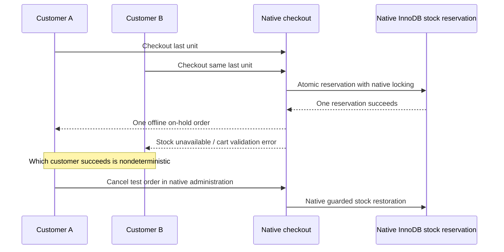

# M03 checkout and inventory flow

M04 retains this offline regression journey and adds [official Checkout Pro](payment-flow.md). In a public test-seller demonstration, `payments --mode pro` enables only the official redirect method and disables BACS. Without credentials, `payments --mode offline` restores the journey below. A browser return never confirms payment; only the official provider-backed receiver may complete it. Public and local carts use separate native cookie sessions.

The storefront uses the installed WooCommerce **11.2.1 Cart and Checkout blocks**, Store API, guest sessions and HPOS. There is no second cart, custom order table, frontend price calculator, payment endpoint or custom order status.

## Customer journey

1. Add a native catalog/product item. WooCommerce validates visibility, variation, purchase limits and stock.
2. On Cart, change quantities, remove items, apply a coupon or review an estimate. WooCommerce recalculates every amount and maintains its standard cookie session.
3. Proceed as a guest. Native fields collect email, name, Uruguay country/department, locality, street, optional apartment, postcode and required phone. Labels are localized without duplicating fields. Use test data only.
4. A department change matches its native shipping zone. Choose DAC or UES, both explicitly labelled sample flat rates. A new zone has different method-instance IDs and may reset selection to its first available method; review the selected rate again.
5. Review the native summary and acknowledge the provisional terms/privacy links. The offline test gateway is visibly marked **DEMO — Pedido de prueba · sin pago**. It has no bank account information.
6. Submit through the native checkout. Its loading/disabled state protects normal duplicate clicks. Native server validation, stock reservation and order/cart handling remain authoritative even if a browser sends forged requests.
7. Native BACS creates an **on-hold** order, reduces stock once, empties the cart and returns the native order-received URL. No payment is verified and no money is transferred. The confirmation shows products, quantities, dates, totals, shipping/payment methods and native status.
8. Store managers use WooCommerce Orders and Products. Order items, notes, shipping and status controls remain native. No separate dashboard is introduced.

```mermaid
sequenceDiagram
    participant Guest
    participant Blocks as Native Cart and Checkout
    participant API as WooCommerce Store API
    participant WC as WooCommerce / HPOS
    participant Gateway as Native BACS DEMO
    Guest->>Blocks: Add item / change quantity / coupon
    Blocks->>API: Native cart request
    API->>WC: Validate inventory and recalculate
    WC-->>Blocks: Cart, shipping and totals
    Guest->>Blocks: Uruguay address + shipping + terms
    Blocks->>API: Native checkout submission
    API->>WC: Validate address/cart/rate/total; reserve stock
    WC->>Gateway: Process offline test order
    Gateway->>WC: On hold (payment unverified)
    WC->>WC: Native stock reduction once; release reservation
    Gateway-->>Blocks: Native order-received redirect
    Blocks-->>Guest: Confirmation and unpaid status
```

## Inventory and statuses

Initial M03 settings are global tracked stock, low-stock threshold **2**, out-of-stock threshold **0**, no backorders on the three managed physical demo products, and an unpaid pending-order hold of **30 minutes**. Existing prices and quantities are preserved. Native administration can change these values; setup does not overwrite subsequent changes.

The exact behavior below was inspected in the installed `wc-stock-functions.php` and exercised with isolated products/orders. Do not reproduce it in plugin status hooks.

| Native event/status | Inventory consequence |
| --- | --- |
| Cart addition | Validates availability; does not guarantee reservation or reduce physical stock |
| Checkout draft / pending | Native reservation protects units during checkout; physical stock is not reduced merely by pending status |
| On hold | Reduces stock through native guarded callbacks; BACS does not mark the order paid |
| Processing / completed | Native reduction flag prevents another reduction for already-reduced items |
| Cancelled / pending after reduction | Native callbacks restore reduced stock and clear its reduction flag |
| Failed | This installed version restores stock when the order had previously reduced it; an unreduced pending failure does not inflate stock |
| Refunded | Use the native refund dialog and its explicit restock option; a financial refund and physical restock are distinct actions |
| Expired unpaid pending order | Native scheduled cancellation releases held stock; an unreduced order must not add physical units |

**BACS on-hold orders do not automatically expire with the pending-order timer.** Cancel unused offline demo orders in native administration to restore stock. Do not set them processing/completed to simulate a payment notification. Tests explicitly exercise native status transitions; real financial confirmation belongs to M04.



Concurrency testing exposed an intermittent gap in the pinned version: a reducing status is saved before the stock-reduction callback, while the native reservation query normally counts only draft/pending orders. Another request can briefly see neither the reservation nor reduced stock. `includes/stock-reservation.php` uses the supported **`woocommerce_query_for_reserved_stock` read filter** to keep existing reservations countable during on-hold/processing/completed until the native release callback deletes them. During the reduction/release interval this can be conservatively restrictive; it does not allocate extra stock, change statuses or write quantities. Native locking and every stock write remain unchanged. The predicate extension supports the inspected HPOS/CPT query shape and must be reviewed with WooCommerce upgrades.

Tests observe that reservation from a read-only status listener before native reduction runs, and exercise real concurrent Store API checkouts. They do not patch stock internals or change merchant inventory. No direct SQL order mutation is used. The supported filter is documented in the [official reservation helper source](https://github.com/woocommerce/woocommerce/blob/trunk/plugins/woocommerce/src/Checkout/Helpers/ReserveStock.php).

## Confirmation access and local email

Native order keys, guest verification/session rules and account access checks protect order detail blocks. No email, name or address is appended to a URL. The order key is an access secret: do not publish it. Tests verify missing/invalid keys do not expose the synthetic address.

All outbound WordPress mail remains suppressed. In local/development environments only, the foundation plugin captures up to **10 previews**, each capped at **100,000 characters**, when every recipient uses the reserved `.invalid` suffix. Other recipients are suppressed without capture. The capture uses a non-autoloaded core option, accessible only under **WooCommerce → Correos DEMO** with both `manage_woocommerce` and `manage_options` (administrator access; global previews may include account-recovery messages). Clearing it requires a nonce. Preview HTML is escaped into a sandboxed frame with a restrictive content policy. No SMTP service or external mailbox is needed.

Native WooCommerce email colors/footer match M02. Captured output is evidence of email generation, **not delivery**. Real destination details were not supplied; use non-contactable test identities. The contact form still validates only and never calls email delivery.

## Mercado Pago readiness and limits

The [official Mercado Pago listing](https://woocommerce.com/products/mercado-pago-checkout/) declares Cart/Checkout Blocks, HPOS and Uruguay support. Its [changelog](https://github.com/mercadopago/cart-woocommerce/blob/main/CHANGELOG.md) records Blocks support since 7.1.0. Checked **2026-10-28**: the listed release is 8.9.7, with tested WooCommerce 11.0.1; this project's pin is 11.2.1. This supports retaining the native block architecture, but does **not** establish runtime compatibility of that exact pair. M04 must verify the selected plugin release, Uruguay sandbox methods and redirect/webhook behavior before enabling them. No classic-checkout fallback is justified by the current evidence.

M04 adds exact-host public HTTPS configuration, native return/receiver rejection tests and an explicit test-seller activation workflow that disables BACS. Genuine payment/notification acceptance remains incomplete. Only provider-backed official processing/native payment APIs may confirm payment. A return-page visit never marks an order paid. Gateway registration, REST/Store API, `wc-api`, native stock hooks and HPOS remain available. See [payment-flow.md](payment-flow.md).

Taxes remain disabled as inherited from M01. The business must confirm tax treatment before production. M03 adds no tax percentages, real carrier integration, online gateway, tunnel or public deployment.
